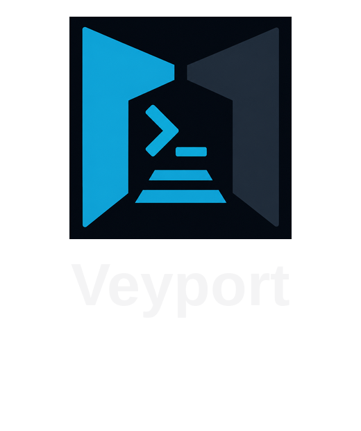
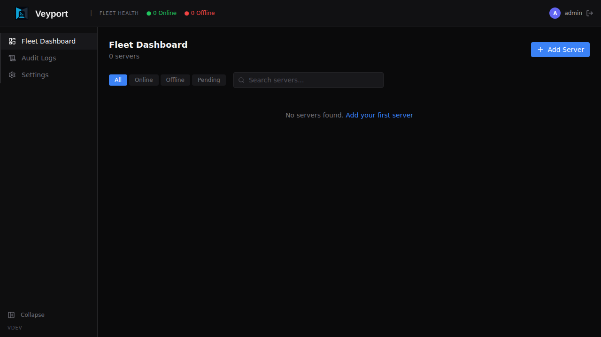

<p align="center">
  
</p>

<p align="center">
  <strong>Secure remote file access and server operations from one web UI</strong><br>
  Browse files, stream logs, open governed terminal sessions, and move data across your servers from a self-hosted control plane built for small fleets.
</p>

<p align="center">
  <a href="https://github.com/lorconksu/veyport/actions/workflows/ci.yml">
    
  </a>
  <a href="https://sonarcloud.io/summary/new_code?id=lorconksu_veyport">
    
  </a>
  <a href="https://github.com/lorconksu/veyport/releases">
    
  </a>
  
  
  <a href="https://github.com/lorconksu/veyport/blob/main/LICENSE">
    
  </a>
</p>

<p align="center">
  
</p>

## What is Veyport?

Veyport gives you secure, day-to-day access to your servers through one self-hosted web interface. Browse remote file systems, stream logs in real time, open governed shell sessions, and transfer files without handing out SSH keys or bouncing between terminal sessions.

The Standard profile runs as a single binary with no external service dependencies. The Hub embeds the full React frontend and uses SQLite for local state. An opt-in Enhanced audit profile adds an external receipt and encrypted archive service for protected command admission; it is not required for ordinary fleet access.

Veyport is built for home lab operators and small teams who need dependable access, useful audit metadata, and tight operational control. Authenticated users must enroll in TOTP, and permissions are checked at the Hub and agent boundaries.

Veyport is open source software licensed under the Apache License 2.0. The
software license does not grant rights to the `Veyport` name or logos; see
[TRADEMARKS.md](TRADEMARKS.md) for branding rules and [CONTRIBUTING.md](CONTRIBUTING.md)
for issue and pull-request expectations.

## Features

- **Fleet Dashboard** — At-a-glance health overview of all connected servers with live status, search, and filtering
- **Real-time Log Tailing** — Live log streaming over SSE with server-side grep/filter, pause/resume, and terminal-like UI
- **Live Browser Terminal** — xterm-based shell sessions over the existing agent stream for admins and authorized LDAP users
- **Remote File Browser** — Browse remote file systems with syntax highlighting for 16 languages; resizable sidebar, refresh button, and binaries/forbidden paths shown but greyed out
- **Secure File Transfers (Dropzone)** — Admin-only drag-and-drop chunked file uploads to a quarantined staging directory on the target server
- **Email Notifications** — 8 configurable alert types (agent connect/disconnect, file uploads, login events, and more)
- **Audit Logging** — Local audit metadata for security and workflow actions; optional Enhanced command evidence uses external admission receipts and encrypted originals
- **Command Passthrough** — `vey ssh <node> -- '<command>'` runs one opaque command through the Hub without a PTY and keeps stdout, stderr, stdin, and exit results separate
- **Verified Updates** — `vey update` updates the local CLI from its configured Hub; `vey servers update <node>` updates supported Standard agents while preserving their enrolled identity and configuration
- **Optional Enhanced Audit** — External admission receipts and encrypted original evidence for covered commands, with redacted search projections kept separate
- **2FA (TOTP)** — Mandatory TOTP-based two-factor authentication for all users, no exceptions
- **Role-Based Access** — Admin, Auditor, and Viewer roles with per-server, per-path permissions enforced at both Hub and Agent layers
- **LDAP Directory Integration** — Sign in against your existing directory (FreeIPA, OpenLDAP, AD) with group-to-role mapping, configured entirely from the admin UI with a built-in connection tester
- **mTLS Agent Communication** — Hub-issued short-lived ECDSA P-256 client certificates with automatic in-stream renewal; cert lifetime is configurable via `agent_cert_validity_hours` (default 24 h)
- **Self-Healing Re-enrollment** — Nodes whose certs expire while offline recover automatically via human-approved re-enrollment, preserving the same server identity, history, and path assignments without a fresh registration

## Architecture

Veyport uses a **Hub-and-Spoke** model. The Hub is the central server that hosts the web UI, REST API, and SQLite database. Agents are lightweight binaries deployed on each remote server, maintaining persistent gRPC streams back to the Hub.


- **Hub** — Central Go server. Serves the web UI, exposes REST APIs, manages SQLite, and enforces authentication and permissions. Runs HTTP on `:8081`, agent gRPC on `:9090`, and an SSH gateway on `:2222` by default.
- **Agent** — Lightweight Go binary on each remote server. Maintains a persistent bidirectional mTLS gRPC stream to the Hub, executing file, log, upload, and PTY terminal operations on demand.
- **CLI (`vey`)** — Connects to the Hub over HTTPS for API operations and SSH certificates, then uses native SSH for interactive PTY access or (on the feature branch) one no-PTY command through the Hub gateway and agent stream.
- **Frontend** — React SPA embedded into the Hub binary via `go:embed`. Single-binary deployment with zero external dependencies.

For the full architecture breakdown, see [Architecture](docs/wiki/Architecture.md).

Browser and CLI shells share the same authorization and execution identity: local
admins inherit the agent account (**root** under the standard installer); LDAP
users run as their mapped host account. See [SSH Gateway](docs/wiki/SSH-Gateway.md)
for connection requirements and [Architecture](docs/wiki/Architecture.md#session-activity-and-lifetimes)
for the current request-based session activity model.

Enhanced command evidence covers the submitted command string or complete
supported stdin script. It does not attest every internal shell instruction,
fetched program, child-process action, or remote output; command execution is not
a sandbox. The prototype identity is version `2.0.50-prototype.4` and immutable
tag `prototype-ssh-passthrough.4`; stable `2.0.49` does not include this
feature. Before installing, check the [prototype release page](https://github.com/lorconksu/veyport/releases/tag/prototype-ssh-passthrough.4)
for an actually published release and its required assets. If they are absent,
the prototype is unavailable. Use the Hub and CLI from the same source revision
with a compatible agent. Resolve the immutable OCI tag to its published digest
and verify the source revision. See
the public [Architecture guide](docs/wiki/Architecture.md#command-execution-boundary)
for its guarantees and limits.

## Quick Start

```bash
# Download the compose file
curl -O https://raw.githubusercontent.com/lorconksu/veyport/main/docker-compose.yml

# Start Veyport
docker compose up -d
```

The Hub starts on port 8081 (HTTP) and 9090 (gRPC). Open `http://localhost:8081` to create the initial admin account and set up 2FA.

### Agent Installation

From the Hub web UI, click **Add Server** and run the generated install command on each target machine:

```bash
curl -fsSL https://<hub-address>/api/install.sh | sudo bash -s -- \
  --hub <hub-address>:9443 \
  --token <registration-token>
```

The agent installs as a systemd service, connects to the Hub over gRPC with mTLS, and appears on the dashboard within seconds.

Use the enrollment command for new nodes. For upgrades, use `vey update` for
the local CLI and `vey servers update <node>` for a supported enrolled agent.
Agent updates require an interactive administrator session and a Standard
installation that has never enrolled governance controls. The built-in update
flow preserves node identity and configuration; the install script's existing
replacement path unregisters and re-enrolls an agent. See the
[Deployment Guide](docs/wiki/Deployment.md#update-the-cli-and-enrolled-agents)
for platform limits, bootstrap, and recovery details.

## Tech Stack

| Layer | Technology |
|-------|-----------|
| Backend | Go 1.26+ |
| Frontend | React 19 + TypeScript + Vite + Tailwind CSS v4 |
| Database | SQLite (WAL mode, via `modernc.org/sqlite`, pure Go) |
| Hub-Agent | gRPC with bidirectional streaming + mTLS (ECDSA P-256) |
| Hub-Browser | REST + SSE (Server-Sent Events) |
| UI Components | shadcn/ui (heavily customized) + lucide-react icons |
| Syntax Highlighting | highlight.js (16 languages) |
| Markdown | react-markdown + remark-gfm + Mermaid diagrams |

## Security

| Area | Implementation |
|------|---------------|
| Password Hashing | bcrypt (cost 12) |
| Two-Factor Auth | TOTP with mandatory enrollment for all users |
| Session Tokens | JWT with httpOnly / Secure / SameSite=Strict cookies |
| CSRF Protection | Double-submit cookie pattern |
| Rate Limiting | Per-IP rate limiting on auth endpoints |
| XSS Protection | DOMPurify sanitization + Content Security Policy headers |
| Path Traversal | Server-side path canonicalization + symlink resolution |
| Sensitive Paths | Blocklist enforcement at both Hub and Agent layers |
| Agent Auth | mTLS with Hub-issued 12-hour ECDSA P-256 certificates |
| SMTP Credentials | AES-256-GCM encryption at rest |
| LDAP Bind Credentials | Encrypted at rest, write-only API (never returned after saving) |
| LDAP Transport | LDAPS or StartTLS required unless insecure transport is explicitly opted in |
| Token Blacklist | Persistent across restarts (SQLite-backed) |
| Session Invalidation | Password change invalidates all sessions |
| gRPC Limits | 256 KB max receive message size |
| Version Disclosure | Hidden from unauthenticated users |
| Cache-Control | `no-store` on all API responses |

## Documentation

- [User Wiki](docs/wiki/) — End-user documentation and walkthroughs
- [Architecture](docs/wiki/Architecture.md) — Hub, agent, and transport model
- [API Reference](docs/wiki/API-Reference.md) — REST API endpoints and auth flow
- [Deployment Guide](docs/wiki/Deployment.md) — Docker-first deployment and runtime flags
- [Proxy Configuration](docs/wiki/Proxy-Configuration.md) — Reverse proxy and gRPC passthrough setup
- [Development Guide](docs/wiki/Development.md) — Local development workflow and test commands
- [SonarCloud](https://sonarcloud.io/summary/new_code?id=lorconksu_veyport) — Public code quality, coverage, and maintainability dashboard

## License

Veyport is open source software licensed under the [Apache License 2.0](LICENSE). See [NOTICE](NOTICE) for attribution details and [TRADEMARKS.md](TRADEMARKS.md) for name and branding rules.
