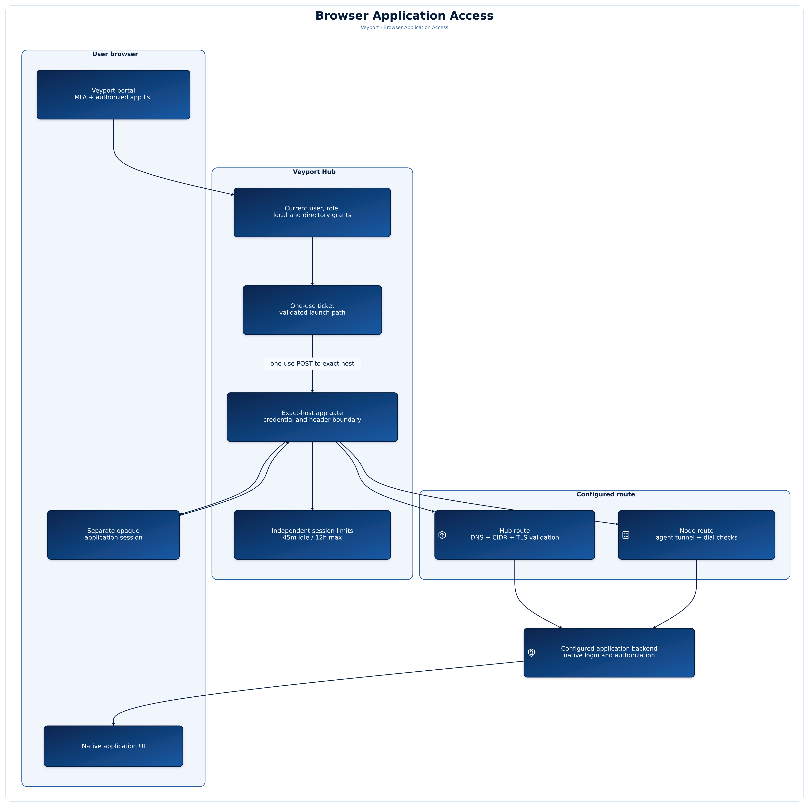

# Browser Application Access

This feature is under review on the application-access prototype branch. It is not included in stable v2.0.52. The prototype PR remains unmerged; deployment and public hostname availability must be verified separately.

Veyport can publish links to administrator-configured web applications through an exact application-host namespace. A signed-in user sees only applications currently authorized by a direct user, role, local application group, or directory-group grant. Selecting **Open application** starts the Veyport launch flow and opens the application in a new tab. When a user must sign in first, Veyport returns only to the validated application launch path after login and TOTP.

Launch and application documents use `Referrer-Policy: strict-origin`: browser requests may disclose only the source origin, never the native path or query, and do not send a referrer on an HTTPS-to-HTTP downgrade. This policy preserves the browser Origin header required for the launch POST and native forms. Launch documents and ticket responses are not cached.

The browser receives a separate opaque application session. It does not send the portal access or refresh cookies to the application backend. Application sessions default to 45 minutes idle and 12 hours maximum; administrators can change both limits. The limit is independent from portal session policy. Users can inspect and revoke their application sessions in the sessions list below the available application cards on the **Applications** page. The current administration view does not include a separate application-session list. Ending an application session closes its active streams.

Accepted HTTP requests reset the application idle timer, including background requests made by the application. Bytes sent over an existing WebSocket or server-sent event stream do not reset it. The maximum lifetime is measured from the original completed Veyport MFA sign-in, so opening another application or refreshing a page does not extend that limit. Reaching the maximum requires a new sign-in with MFA. Signing out of Veyport also revokes application access, even when the portal session has already expired.

## Administration

Users with `operations.admin` can create and update application records, set their grants, manage local application groups, and change the application session policy. Application configuration includes its published hostname, Hub or managed-node route, backend URL, allowed destination CIDRs, optional custom CA trust certificate, and enabled state. The backend URL and CA settings are administrator-only; they are not shown on the user application list.

A local application group is separate from Veyport's role system. Its members can be selected from the paginated Veyport user list. Directory grants use the directory identity returned by the configured directory lookup; if directory lookup is unavailable or cannot establish a fresh identity, access fails closed. Grants are additive: a matching grant of any supported kind authorizes the user.

Administration permission does not automatically grant access to an application's contents. Administrators also need a matching application grant to open it. Application grants are separate from SSH access permissions.

Deleting an application, changing its configuration or grants, changing group membership, disabling a user, or revoking a session can end active application sessions. These changes are audited. Audit entries record administrative and access events, not application page content or actions inside the native application.

## Application endpoints

All paths below are on the Hub origin. Portal endpoints use the existing authenticated browser session, CSRF protection on writes, and live management capabilities. Admin configuration endpoints require `operations.admin`.

| Endpoint | Purpose |
|---|---|
| `GET /api/applications` | Paginated list of authorized applications and availability. |
| `POST /api/applications/{id}/launch` | Create a short-lived, one-use launch ticket for a validated relative path. The ticket is exchanged by a browser form POST to the exact application host; it is not a URL query parameter. |
| `GET, POST /api/admin/applications` | List or create application configuration. |
| `GET, PUT, DELETE /api/admin/applications/{id}` | Read, update with `expected_version`, or delete an application. A stale version returns `409`. |
| `GET, PUT /api/admin/applications/{id}/grants` | Read or transactionally replace direct user, role, local-group, and directory-group grants using `expected_version`. |
| `GET, POST /api/admin/application-groups` | List or create local application groups. |
| `GET, PUT, DELETE /api/admin/application-groups/{id}` | Read, update membership with `expected_version`, or delete a group. |
| `GET, PUT /api/admin/application-settings` | Read or update `idle_seconds` and `max_seconds` with `expected_version`. |
| `GET /api/admin/application-subjects/users` | Search a bounded user page with `limit`, `offset`, and optional `q`. |
| `GET /api/admin/application-subjects/directory-groups` | Search directory group subjects by optional `q`; use returned `subject_id` unchanged. |
| `GET /api/auth/application-sessions` | List the current user's application sessions and expiry information as `{sessions:[...],total}`. |
| `DELETE /api/auth/application-sessions/{id}` | Revoke one of the current user's application sessions. |

See [[API Reference]] for shared authentication and error behavior. See [[Deployment]] for the Hub flags and DNS/TLS routing requirements. This feature documentation describes configuration and expected behavior; it does not state that an application namespace or public deployment is currently available.
