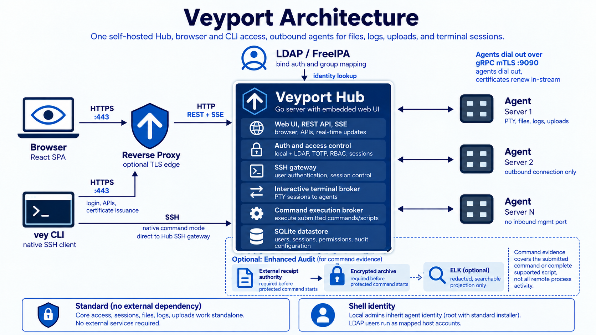
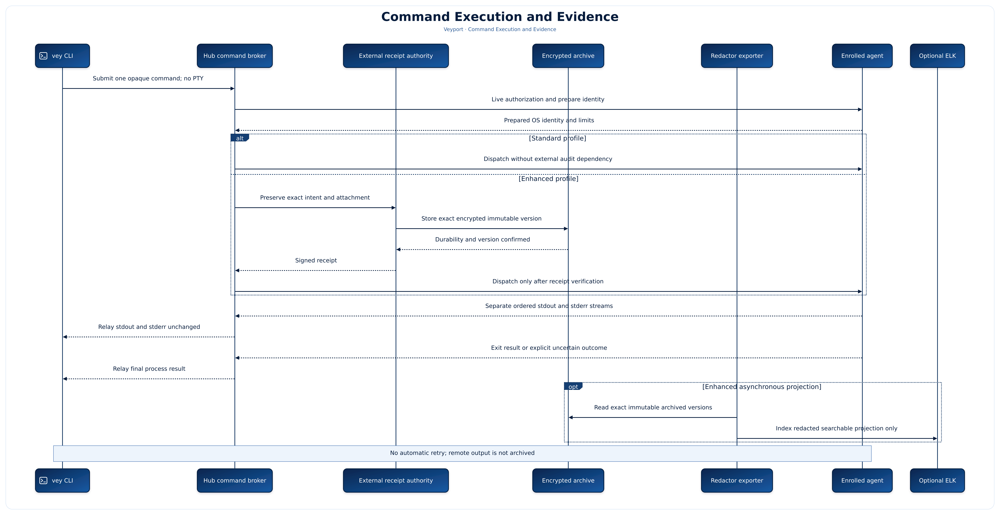
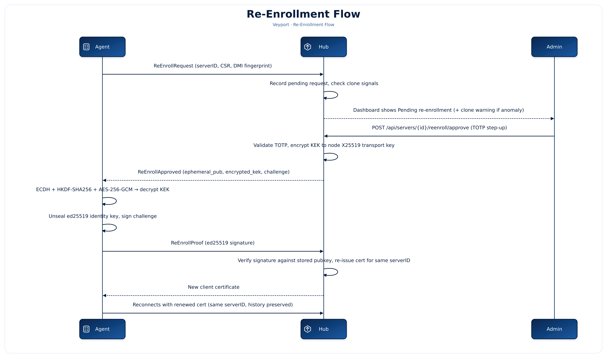

# Veyport Architecture

Veyport uses a **Hub-and-Spoke** model. The Hub hosts the web UI, REST API, SSH gateway, and SQLite database. Browsers and the `vey` CLI connect to the Hub; agents deployed on managed servers maintain persistent gRPC streams back to it.



## Components

- **Browser** - React single-page app served by the Hub over HTTPS.
- **CLI (`vey`)** - Standalone client for HTTPS API operations and native SSH. On the `011-cli-command-passthrough` feature branch it can also submit one no-PTY command through the same gateway. The Hub serves platform-specific CLI binaries through `/install/cli/{os}/{arch}`.
- **SSH gateway** - Hub listener on `:2222` by default. Validates Hub-issued SSH certificates, checks live authorization, and brokers interactive PTY or command execution over the enrolled agent stream; it does not connect to the managed server's SSH daemon.
- **Hub** - Go server that serves the web UI, exposes REST APIs, stores state in SQLite, enforces authentication and authorization, and brokers requests to agents.
- **SQLite** - Local persistent store for users, sessions, audit logs, server inventory, configuration, and persisted gateway keys.
- **Agent** - Lightweight Go binary running on each managed server. It maintains a long-lived gRPC connection to the Hub and performs file, log, upload, PTY terminal, and feature-branch command operations on demand.
- **Optional Enhanced audit services** - A separately operated receipt authority and encrypted archive gate covered command admission. ELK receives redacted projections for search; it is not the receipt authority. Standard mode has no dependency on these services.

## Data Flows



- **Browser -> Hub** - HTTPS for the web UI, REST API calls, and SSE log streaming.
- **CLI -> Hub HTTP** - HTTPS for login, fleet/file/log operations, and SSH certificate issuance.
- **CLI -> Hub SSH gateway -> Agent** - The CLI invokes the operator's native SSH client. Interactive mode uses the PTY path. Command mode uses one exact SSH exec request with no PTY, a prepared identity, bounded streams, and explicit process/evidence results.
- **Hub -> SQLite** - Local database access with WAL mode for persistent state.
- **Agent <-> Hub** - Long-lived gRPC over mTLS for registration, heartbeats, file operations, log tailing, uploads, terminal sessions, and certificate renewal.
- **Enhanced command admission** - The Hub preserves the exact intent through the external receipt/archive service before dispatch. Search indexing is asynchronous and redacted; it does not authorize a command.

## Security Boundaries

- All user access goes through the Hub, which enforces session auth, TOTP, RBAC, and per-server or per-path authorization.
- Browser and SSH terminal sessions share `AuthorizeTerminalExecution`: admins are permitted; other users must be LDAP users with terminal access and a root (`/`) path assignment on the target server. API tokens cannot open browser terminal sessions or obtain SSH certificates.
- Veyport authentication identifies the operator; it does not by itself select the OS account running the shell. See the execution identity table below.
- Agents do not accept inbound management traffic from the Hub. They dial out to the Hub, which reduces exposed attack surface on managed hosts.
- Agent connections use Hub-issued client certificates for mTLS after bootstrap registration.
- Standard retains local audit metadata and does not need an external audit service. Enhanced mode refuses new protected work when its required external receipt path is unavailable; already admitted work has a separate process lifecycle.
- Execution actor and target OS identity are separate values. Identity is resolved by the agent before launch and is reused for the process start. A missing preparation is unknown, not root; UID 0 is root only when the actual prepared UID is zero.
- Process results and evidence results are separate states. A command can finish while completion evidence remains unconfirmed. Archive intent proves preserved intent, not successful start or completion.
- Enhanced evidence covers the submitted opaque command or complete supported finite script, not every internal shell command, dynamically fetched program, child-process action, or remote output. Command execution is not a sandbox and does not provide complete host process telemetry.

## Command execution boundary

The feature-branch invocation has one command-string argument after `--`:

```bash
vey ssh web01 -- 'uname -a'
```

There is no PTY in command mode. Standard forwards ordinary stdin. Enhanced mode
accepts either empty stdin or a complete script for exactly `bash -s`,
`/bin/bash -s`, `sh -s`, or `/bin/sh -s`; the script is collected and verified
before launch (maximum 16 MiB and 120 seconds). Output streams are independently
ordered, and no total ordering between stdout and stderr is promised. The remote
result is propagated, but exit 255 can overlap SSH transport failure. Commands
are not automatically retried after uncertain outcomes.

For both Standard and Enhanced execution, the Hub's sole agent-stream sender
rechecks live policy, actor/access authority, and target-node state immediately
before sending `Start`. It also checks cancellation and that the captured agent
control connection is still current after queued dispatch. This closes stale
queued-start paths, while a start already sent cannot be recalled; a subsequent
send or connection failure can leave the remote outcome unknown. Revocation is
not an atomic guarantee that a process already starting or running has stopped.

No per-command run-as option exists. The agent resolves user, UID/GID/groups,
home, shell, and working directory before admission. Local admins inherit the
agent service identity (root with the standard installer); mapped directory
accounts use their resolved host identity. The authorization and execution
identity boundary is an application control, not containment of a privileged
remote user or host administrator.

## Enhanced trust and prototype limits

Enhanced command intent is archived as exact versioned content and bound to a
signed admission receipt. The archive and signing authority are separate from the
Hub. The receipt allows a matching prepared execution to proceed; it does not
attest the command's behavior or completion. ELK stores a redacted searchable
projection that can be rebuilt from archived evidence.

Policy reads verify the exact stored bytes against their SHA-256; the digestless
compatibility exception is limited to the original version-1 Standard record.
Before actor/node scope chooses an execution or interactive path, the Hub checks
local enrollment-marker and exact approval continuity, including both sides of a
pending transition. Changing policy bytes and recomputing the database digest
cannot replace that continuity. An approved return to Standard remains governed
and can use its local authorization while the archive is offline. Startup and
recovery continue to authenticate the latest external anchor.

The current lab qualification is a prototype configuration, not a compliance
certification or production high-availability claim. It uses a single ELK guest,
a shared hypervisor root boundary, and manually unlocked encrypted storage. A
receipt promises 24-hour retention for execution originals while the storage
backend currently keeps them for two days; seven-day search metadata can outlive
the export guarantee for the raw originals. Governance evidence uses a 3650-day
promise against a 3651-day prototype backend setting. A database or enrollment
marker rollback with the same trusted installation identity and external
authority is checked against the latest authenticated external anchor and fails
closed when it cannot reconcile. Replacing the trusted binary, runtime trust
configuration, or installation identity as root/hypervisor administrator is
outside the tested application boundary, as are host destruction and key loss.
See the repo-local [audit lab notes](../../infra/audit-lab/README.md) for
qualification detail. This branch targets version `2.0.50-prototype.5` and
immutable tag `prototype-ssh-passthrough.5`; stable `2.0.49` does not include
this feature. Before installing, verify publication, required assets, and
qualification on the [release page](https://github.com/lorconksu/veyport/releases). Use the Hub and CLI from the same source revision
with a compatible agent. Resolve the immutable OCI tag to its published digest
and verify the source revision.

## Terminal Execution Identity

The SSH gateway and browser terminal use the same agent PTY manager. The Hub sends
`TerminalOpenRequest.run_as_user` after authorizing the operator:

| Veyport account | Agent execution identity |
|---|---|
| Local admin | Empty `run_as_user`: inherit the agent process identity. The standard systemd installer omits `User=`, so the agent and shell run as **root**. |
| LDAP admin | Mapped LDAP username on the managed host. |
| LDAP user with terminal access and a `/` assignment | Mapped LDAP username on the managed host. |
| Other local users or LDAP users without required permissions | Terminal access refused. |

For a mapped user, the agent resolves the host account, applies its UID, GID, and
supplementary groups, and uses its home directory when no working directory was
requested. A missing mapped account fails instead of falling back to root. `vey ssh`
has no option to choose an arbitrary OS user. A `/` assignment is an authorization
requirement, not a filesystem sandbox; shell access follows the selected account's
OS permissions. See [[SSH Gateway]] and [[Server Detail]].

## Session Activity and Lifetimes

Completed browser and CLI sign-ins create server-side sessions. Access and refresh
tokens bind to the session ID. The default idle limit is **15 minutes** and the
absolute lifetime is **12 hours**; administrators configure both in Account policy.
Validated authenticated requests update `last_seen_at`, with writes throttled to
`min(60 seconds, idle limit / 10)` (60 seconds when idle expiry is disabled).
Refreshing a session atomically rotates only that session's one-use refresh token.
It leaves other sessions and still-valid access tokens untouched. Logging out,
session expiry, account or security changes, and explicit session revocation keep
their existing revocation behavior.

Signed-in pages also report recent keyboard, pointer, input, touch, and scroll
interaction through `HEAD /api/auth/me`, independently of data polling. Checks are
throttled to one per 15 seconds and stop when the tab is hidden or interaction has
been absent for 30 seconds. Merely opening or returning to a visible tab does not
start these checks. Each activity request and the shared token refresh have a
10-second timeout. Network failures can be retried during recent activity; only
the Hub decides whether a session is still valid. Existing authenticated data
polling also counts as activity, so visible polling can keep an unattended tab
alive until its absolute limit. See [[Logging In]] and [[Troubleshooting]].

SSH certificates have a separate validity period and are checked when connecting.
Established shells are not governed by HTTP session idle or absolute timers, and
certificate expiry does not terminate an existing SSH connection. Administrative
session revocation and account disable can close running shells through the shared
terminal registry. See [[SSH Gateway]] and [[Settings]].

## Agent Certificate Lifecycle

Agent connections are authenticated with **Hub-issued short-lived client certificates** over mTLS. The certificate lifetime is configurable (`agent_cert_validity_hours`, default 24 h).

- **Auto-renewal (adopt-live):** While an agent is connected, it requests renewal approximately 6 hours before expiry. The Hub independently verifies the current authenticated mTLS peer and connection before issuing a fresh certificate over that stream; bootstrap approval is not a renewal credential.
- **Expiry recovery (re-enrollment):** If a node is offline longer than its certificate lifetime the cert expires and the node cannot reconnect on its own. The agent requests re-enrollment over a separate CA-pinned bootstrap stream. The Hub places the exact request in **Pending re-enrollment** until an admin approves. Approval permits one challenge proof on that same stream; only after verifying the node's proof does the Hub return a certificate. The bootstrap stream remains bootstrap-only and closes; the agent then reconnects with the new certificate, which the Hub verifies before normal routing.

### Re-Enrollment Flow



### Re-Enrollment Security Model

- Each node holds a durable **ed25519 identity key** sealed at rest under a **KEK** held by the Hub, plus an **X25519 transport key** (public half registered at enrollment; private half stored unsealed at `node_transport.key`).
- Approval releases only the challenge exchange for that exact request and originating bootstrap stream. The agent proves possession of its durable ed25519 identity key by signing the Hub challenge; the Hub verifies the proof before issuing the new certificate. Approval alone does not issue a certificate or authorize normal agent traffic.
- The **human TOTP step-up** is required to approve; it does not replace the node's proof.
- **Clone detection:** the node's DMI system UUID recorded at enrollment is compared on each re-enrollment request; a mismatch surfaces as a **"possible clone"** warning at approval time (advisory, not a hard block).
- **Legacy nodes** enrolled before transport keys were introduced cannot re-enroll; the approval endpoint returns **409 "re-register required"** and the node must be re-registered once to gain transport-key support.

---

## Related Guides

- [[Deployment]] - General deployment model and runtime flags
- [[Proxy Configuration]] - Reverse proxy and gRPC passthrough details
- [[Development]] - Local development architecture and repo layout
