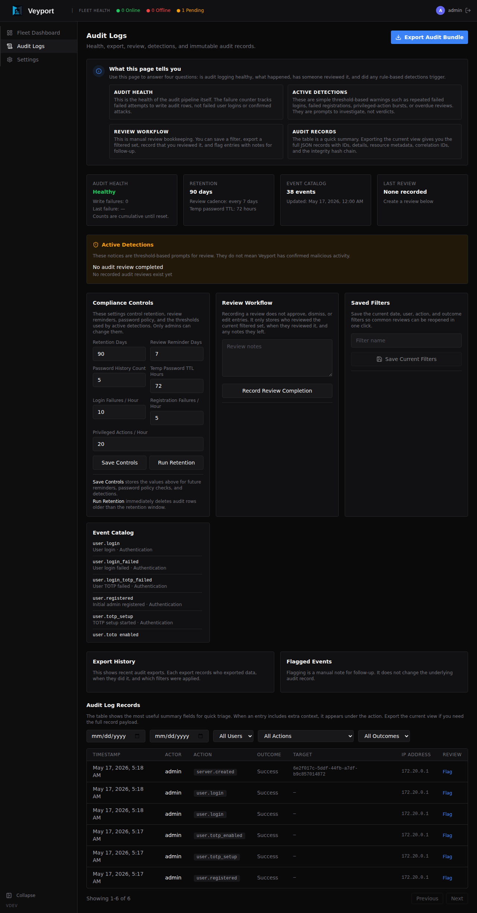

# Audit Logs

## What Are Audit Logs?

Veyport keeps local audit metadata for security and operational actions. The
optional Enhanced command profile adds externally preserved command-intent and
policy evidence. The two stores have different availability, retention, and
integrity properties; a local log row alone is not proof of external evidence.

The existing local action log uses its configured retention and local integrity
checks. Enhanced original records are stored by exact immutable object version
and accompanied by an external receipt. Neither mechanism protects against loss
of the Hub host, its privileged operator, encryption keys, or the shared lab
hypervisor. Review [[Architecture]] for the trust boundary.

Policy records are checked against the SHA-256 of their exact stored bytes.
Command and interactive authorization also verifies local enrollment and the
exact approved change before selecting Standard or Enhanced scope. Corrupted or
inconsistent policy state cannot supply a Standard fallback, and an approved
return to Standard keeps its security governance. Startup and recovery check the
latest external anchor; normal approved Standard access does not require the
archive to remain online.

The audit log is visible to principals with **audit.read**, including admins,
auditors, and original-readers. Before governance enrollment, Standard admins can
also manage retention and threshold settings. Once enrolled, these settings
require a protected request and two independent approvals, including after an
approved return to Standard. Audit readers can review, export, filter, and flag
events without gaining settings authority.

---

## Viewing the Audit Log

Navigate to **Audit Logs** in the sidebar.

Each entry shows:

- **When** - the date and time of the action
- **Who** - the username of the person who performed the action (or "System" for automated actions)
- **Action** - what was done (see action types below)
- **Target** - the resource that was affected (e.g. a username or server name)
- **Details** - any additional context
- **IP Address** - the IP address the request came from

At the top of the page you will also see summary cards for:

- **System health** - whether the audit pipeline is healthy or degraded
- **Retention** - the current retention window
- **Last review** - the most recent recorded audit review

If the system detects unusual patterns, an **Active Detections** panel appears above the log table.

---

## Filtering the Log

Use the filters at the top of the page to narrow down the log:

- **Date range** - Show entries between a start and end date/time
- **User** - Filter to actions by a specific user
- **Action type** - Filter to a specific category of action (e.g. `user.*`, `server.*`, `file.*`, `terminal.*`)

You can combine filters. Click **Clear** to reset them.

You can also save the current filter set for reuse later. Saved filters appear in the workflow panel and can be re-applied with one click.

---

## Pagination

The audit log displays entries in pages. Use the navigation controls at the bottom of the log table to move between pages:

- **Previous / Next** - Move one page forward or back
- **Page indicator** - Shows which page you are on and the total number of pages

The log is sorted with the most recent entries first. Filters are preserved as you navigate between pages.

## Execution investigation and original access

The feature-branch **Executions** view is separate from the general local action
log. It lists redacted execution metadata and lets authorized investigators filter
by actor, node, prepared OS username, policy version, process state, and evidence
state. Details distinguish the Veyport actor from the resolved OS identity. A
missing preparation is shown as unavailable; UID `0` is shown as root only when
the agent actually prepared UID `0`.

Process outcome and evidence state are separate. For example, an execution may
have an exit result while completion evidence is still unconfirmed. Pending
reconciliation is not reported as success, and missing receipts do not imply a
successful command. ELK, when configured, contains redacted searchable projections;
its indexing acknowledgement is not an execution receipt. Search projection
lag does not remove an already preserved archive record.

Ordinary list/detail responses omit raw command/script bytes, remote output,
receipt tokens, and storage locations. A hash or byte count is useful for
correlation but does not let an investigator reconstruct the content.

Original access is a separate capability, `audit.original.read`, and requires an
interactive session, completed TOTP, a specific purpose, and a fresh
action-bound proof. Select exactly one retained envelope or script for each
request. Veyport shows its exact immutable version, digest, and length before
confirmation. After required intent evidence is preserved, the Hub issues a
one-use handle that expires within 60 seconds. The download rechecks current
authority, does not follow redirects, and cannot be replayed or automatically
retried. A failed or interrupted delivery must be treated as uncertain; it does
not mean the investigator saved the bytes. The Hub response byte count is not
proof of a file being saved on the client.

Closing the dialog, losing authority, changing identity, or receiving a refusal
clears pending local download state. Do not copy original content into routine
notes, screenshots, or issue reports. Original access is retained as separately
bounded evidence and does not recreate a download handle during recovery. See
[[API Reference]] for exact endpoints and limits.

---

## Export, Review, and Flag Workflow

The Audit Logs page also supports a lightweight review workflow:

- **Export** - download the currently filtered audit set as JSON with an export manifest
- **Record Review Completion** - store a review note and timestamp for the current filtered view
- **Saved Filters** - keep commonly used filter combinations for later reviews
- **Flagged Events** - attach notes to suspicious entries or filtered result sets

Principals with **audit.read** can use these workflow features. Before governance
enrollment, Standard admins can change retention and detection thresholds;
enrolled installations require the protected change process. The local retention
action remains an operations-admin action and does not change the immutable
external archive's retention.

---

## Reading the Audit Log

Here is a worked example showing how you can trace a server onboarding through the audit log. When an admin adds a server called "web-prod-01" and the agent is installed, you will see these entries in chronological order:

1. **`server.created`** - The admin created the server record in the Hub. The target field shows the server name ("web-prod-01") and the details include any labels that were set.
2. **`server.registered`** - The agent ran the install command on the target machine and completed registration with the Hub. The details show the hostname, IP address, and OS detected by the agent.
3. **`server.connected`** - The agent established a live gRPC connection to the Hub. From this point, the server shows as "Online" on the Fleet Dashboard.

By filtering the audit log to `server.*` actions and a specific date range, you can reconstruct the full lifecycle of any server in your fleet - from creation through registration, connection, disconnection, and eventual unregistration.

---

## Understanding Action Types

Actions follow a `resource.action` naming pattern.

### User actions

| Action | What it means |
|--------|--------------|
| `user.login` | A user successfully logged in |
| `user.login_failed` | A login attempt failed (wrong password) |
| `user.login_totp_failed` | Password was correct but the TOTP code was wrong |
| `user.registered` | The initial admin account was created |
| `user.totp_setup` | A user started the TOTP setup process |
| `user.totp_enabled` | A user successfully enabled TOTP (confirmed their code) |
| `user.totp_disabled` | An admin disabled TOTP for a user |
| `user.totp_reset` | TOTP was reset via the CLI break-glass command |
| `user.created` | An admin created a new user account |
| `user.password_changed` | A user changed a password, including completion of a temporary-password recovery |
| `user.password_reset` | An admin reset an ordinary local account's password; audit details never include the temporary password |
| `user.password_reuse_rejected` | A password change was rejected because it reused a previous password |
| `user.role_updated` | An admin changed a user's role |
| `user.deleted` | An admin deleted a user account |
| `user.locked` | An account was locked after too many consecutive failed sign-in attempts (system actor; detail includes the failure threshold, source IP, and lock expiry) |
| `user.disabled` | An admin disabled a user account (detail includes the number of API tokens revoked as a side effect) |
| `user.enabled` | An admin re-enabled a disabled user account |
| `user.reactivated` | An admin requested dormancy reactivation (detail records whether the dormancy state changed; the audit outcome records success or refusal) |
| `user.unlocked` | An admin cleared a locked account's lock and failure count before it expired on its own (detail `was_locked` records whether the account was actually locked at the time) |
| `user.dormancy_exempt_set` | An admin marked an administrator account "never dormant" |
| `user.dormancy_exempt_cleared` | An admin removed the dormancy exemption from an administrator account, or it was removed automatically because the account's role changed away from admin (detail `role changed` in that case) |
| `session.created` | A web or CLI sign-in completed and a server-side session record was created (detail includes the session id and kind) |
| `session.revoked` | A session (or an SSH/web-terminal shell) was ended before it expired on its own - detail `reason` is one of `revoked_admin` (an admin ended it), `revoked_self` (the owner ended it themselves), `revoked_disable` (a side effect of disabling the account), or `logout` (the owner signed out normally) |
| `session.expired` | A session's next use was refused because a limit was reached - detail `reason` is `idle` or `absolute` (system actor; recorded once, on first detection, not on every subsequent refused attempt) |

When a sign-in attempt is refused because the account is currently locked, it produces a
`user.login_failed` entry with detail `account locked` and a failure outcome, rather than the
usual wrong-password detail. This entry does not change the account's failure count. The same
pattern covers the two other account-lifecycle refusals introduced in feature 008: a disabled or
dormant account refused at sign-in produces `user.login_failed` with detail `account disabled` or
`account dormant`, again as a failure outcome that does not touch the failure count. The
equivalent refusals at the SSH gateway are `ssh.cert_issue_refused` (certificate issuance) and
`ssh.session_refused` (an established certificate, but the shell itself refused), both carrying
the same `account disabled` / `account dormant` reason - see [[SSH Gateway]] and
[[API Reference]].

### Server actions

| Action | What it means |
|--------|--------------|
| `server.created` | An admin added a new server record |
| `server.updated` | An admin edited a server's name or labels |
| `server.deleted` | An admin deleted a server record |
| `server.batch_deleted` | An admin deleted multiple server records in one operation |
| `server.registered` | An agent ran the install command and registered with the Hub |
| `server.registration_failed` | An agent attempted registration with an invalid or expired token |
| `server.connected` | An agent established a live gRPC connection to the Hub |
| `server.disconnected` | An agent's gRPC connection to the Hub dropped |
| `server.unregistered` | An admin unregistered a server - cleanup sent to the agent (if online), then record deleted from the Hub database |

### File actions

| Action | What it means |
|--------|--------------|
| `file.read` | A user viewed or downloaded a file via the file browser |
| `file.uploaded` | A user uploaded a file to a server via the Dropzone |

### Path access actions

| Action | What it means |
|--------|--------------|
| `path.granted` | An admin granted a user access to a filesystem path on a server |
| `path.revoked` | An admin revoked a user's access to a filesystem path on a server |

### Log actions

| Action | What it means |
|--------|--------------|
| `log.tail_started` | A user started a live log tail session on a server |

### Terminal actions

| Action | What it means |
|--------|--------------|
| `terminal.opened` | A user opened a browser terminal session on a server |
| `terminal.closed` | A browser terminal session ended or was cleaned up |

### SSH Gateway actions

| Action | What it means |
|--------|--------------|
| `ssh.cert_issued` | A user's `vey ssh-cert` request produced a signed SSH certificate |
| `ssh.cert_issue_refused` | Certificate issuance was refused (account disabled/dormant, or an API token attempted an interactive-only route) |
| `ssh.session_opened` | An SSH gateway shell was established |
| `ssh.session_closed` | An SSH gateway shell ended - normally (the user disconnected) or, as of feature 009, with detail `reason=forced` when an administrator ended it directly, ended it via **Log out everywhere**, ended it via the user's own **Sign out other sessions**, or disabled the account (see [[Settings]] and [[SSH Gateway]]) |
| `ssh.session_refused` | An established certificate connected, but the shell itself was refused (account disabled/dormant, or no terminal permission) |

### API token actions

| Action | What it means |
|--------|--------------|
| `api_token.created` | A CLI-created API token was created |
| `api_token.revoked` | A CLI-created API token was revoked |

### Agent re-enrollment actions

| Action | What it means |
|--------|--------------|
| `agent.reenroll_requested` | A node phoned home with an expired certificate and requested re-enrollment |
| `agent.reenroll_approved` | An admin approved the re-enrollment request (records the admin's user ID and IP) |
| `agent.reenroll_denied` | An admin denied the re-enrollment request |
| `agent.clone_suspected` | A re-enrollment request tripped a clone-anomaly flag (DMI UUID changed or original node still online) |

### Configuration actions

| Action | What it means |
|--------|--------------|
| `ldap.config_updated` | An admin saved LDAP directory settings from the Directory tab (the change summary never includes the bind password) |

### Audit governance actions

| Action | What it means |
|--------|--------------|
| `audit.exported` | An admin or auditor exported audit entries |
| `audit.review_completed` | An admin or auditor recorded audit review completion |
| `audit.filter_saved` | An admin or auditor saved an audit filter |
| `audit.filter_deleted` | An admin or auditor deleted a saved audit filter |
| `audit.retention_updated` | An admin changed audit retention or detection settings |
| `audit.retention_executed` | An admin ran audit retention cleanup |
| `audit.flag_created` | An admin or auditor flagged an audit event or filtered result set |

Notification delivery attempts are shown in **Settings > Notifications**. They are stored in the notification delivery log rather than the local action log.

### Execution and policy evidence types

Enhanced receipt records use separate event types in the external archive:

| Event | Meaning |
|---|---|
| `execution.admission` | The submitted command intent and its prepared identity/policy binding were preserved before a protected process could start. It does not prove the process started or finished. |
| `execution.lifecycle` | A process state transition or final outcome was recorded. A missing or unconfirmed event remains visible as an evidence problem. |
| `execution.denial` | A protected execution was refused, with redacted metadata describing the denial. |
| `policy.intent` | The exact approved security change intent was submitted to the fixed external authority before local mutation. |
| `policy.commit` | The protected policy transition was committed. |
| `policy.result` | The transition result or a reconciliation outcome was preserved. |
| `policy.anchor` | Enrollment or continuity evidence for the active policy. |

These event names identify external record types, not rows in the existing local
Audit Logs table. Check the execution detail and evidence state before treating a
process outcome as complete. See [[Settings]] for protected approvals and
[[Architecture]] for the prototype's retention and trust limits.
