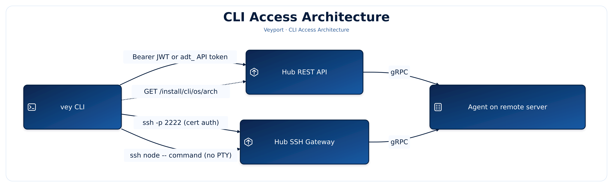

# CLI (`vey`)

> **TL;DR**
> - **What:** `vey` is a standalone command-line client for Hub API operations and native SSH access, including prototype no-PTY command passthrough
> - **Who:** Operators and scripts using eligible API commands; command passthrough requires an operator-issued SSH certificate
> - **Why:** Fleet, file, log, and audit operations have scriptable CLI commands; command passthrough is documented separately because it requires an operator-issued SSH certificate
> - **Where:** One command from your own Hub — `curl -fsSL https://<your-hub>/install/cli.sh | sh` (also under **Install CLI** on the dashboard); binaries are at `/install/cli/{os}/{arch}` for manual installs
> - **How:** Use interactive sign-in (`vey login`) for operator workflows. API tokens support eligible Hub API commands, but cannot obtain an SSH certificate for command passthrough.

---

## Table of Contents

1. [Overview](#overview)
2. [Connect to a server](#connect-to-a-server)
3. [Install](#install)
4. [Update the CLI](#update-the-cli)
5. [Authentication](#authentication)
6. [Configuration](#configuration)
7. [Session awareness](#session-awareness)
8. [Command Reference](#command-reference)
9. [Exit Codes](#exit-codes)
10. [TLS](#tls)
11. [Scripting Notes](#scripting-notes)
12. [Command passthrough](#command-passthrough)
13. [Automation guide](#automation-guide)

---

## Overview

`vey` is a Go binary that talks to the same Hub REST API the web dashboard uses (`Authorization: Bearer <token>`, JSON bodies, `Cache-Control: no-store`). There is no cookie handling and no CSRF token — Bearer requests bypass CSRF the same way a CLI-created API token does. Every request carries `User-Agent: vey/<version>`, which is how the hub tells an interactive `vey login` session apart from a browser when it records a server-side session (see [Session awareness](#session-awareness), below).

`vey` covers fleet visibility, remote file/log access, audit export, native
interactive SSH, and (in the published command-passthrough prototype) no-PTY
command passthrough and protected security administration. There is still no
REST-driven `vey terminal` command mirroring the browser's SSE-based terminal
stream; use the web dashboard's terminal (see [[Server Detail]]) for that
specific flow, or `vey ssh` for a terminal from your own machine (see
[[SSH Gateway]]).




## Connect to a server

After installing `vey`, sign in to your Hub, choose an online server, obtain an SSH
certificate, and connect from an interactive terminal:

```bash
vey --hub https://hub.example.com login
vey servers list
vey ssh-cert
vey ssh web01
```

Replace `web01` with the server's unique name or ID. Login saves the Hub address, so
subsequent commands can omit `--hub`. Obtaining an SSH certificate requires
interactive login, and the operator machine needs a native `ssh` client. A
script can use an already-issued certificate as delegated operator access.

Some released builds, including **2.0.43**, omit `ssh-cert` and `ssh` from
`vey --help` even though both commands are available. Run them directly as shown
above. Re-run `vey ssh-cert` if the stored certificate expires. See [[SSH Gateway]]
for gateway configuration and connection troubleshooting.

### Command passthrough

The feature-branch command mode submits exactly one opaque command after `--`:

```bash
vey ssh web01 -- 'uname -a'
# Standard profile only: Enhanced rejects arbitrary nonempty stdin.
printf 'hello\n' | vey ssh web01 -- 'cat'
```

The client invokes OpenSSH directly and does not run the command in a local
shell. Command mode has no PTY. With no redirected input, stdin is EOF. Standard
mode streams redirected stdin. Enhanced mode requires empty stdin except for the
exact forms `bash -s`, `/bin/bash -s`, `sh -s`, and `/bin/sh -s`, which accept a
complete finite script before preparation and launch. Script arguments and mixed
script/data stdin are not supported. The script cap is 16 MiB and its submission
deadline is 120 seconds.

Stdout, stderr, and remote exit results remain separate. Exit 255 can represent
either a remote result or an SSH transport failure; commands are not automatically
retried after uncertain outcomes. Remote output is not part of the command
evidence. The published command-passthrough prototype is Hub
`2.0.50-prototype.9` / tag `prototype-ssh-passthrough.9`, with CLI and agent
prototype 9 artifacts. Older CLI prototype 6 builds are also compatible with
the Hub. These are prototype builds, not a stable or main-branch release. Check current
publication and qualification on the [release page](https://github.com/lorconksu/veyport/releases)
and verify target agent support. See [[CLI Automation]] for practical scripting
patterns and limits.

## Install

The quickest path is the Hub-served install script — one command on Linux and macOS (it detects your platform, verifies the checksum, and installs to `/usr/local/bin/vey`):

```bash
curl -fsSL https://hub.example.com/install/cli.sh | sh
```

If your account cannot write to `/usr/local/bin`, rerun the installer with `sudo`:

```bash
curl -fsSL https://hub.example.com/install/cli.sh | sudo sh
```

The installer stops with instructions if it cannot install there. A different copy earlier in `PATH` can still be selected by the bare `vey` command, so check resolution after installing:

```bash
type -a vey          # Bash/Zsh: list every copy found on PATH
command -v vey       # show the copy the shell will run
/usr/local/bin/vey --version
```

If `command -v` points to another copy, put `/usr/local/bin` earlier in `PATH`, remove the stale copy if appropriate, and refresh the shell's command cache (`hash -r` in Bash, `rehash` in Zsh, or start a new shell). The same one-liner is available in the web UI under **Install CLI** on the dashboard.

### Manual install (verify by hand)

Binaries are served directly by your own Hub — there is no separate download site. Pick your platform and verify the checksum before running anything:

```bash
# Linux, amd64
curl -fLo vey https://hub.example.com/install/cli/linux/amd64
curl -fs https://hub.example.com/install/cli/linux/amd64/sha256
sha256sum vey    # compare against the value printed above
chmod +x vey && ./vey --version
```

```bash
# Linux, arm64
curl -fLo vey https://hub.example.com/install/cli/linux/arm64
curl -fs https://hub.example.com/install/cli/linux/arm64/sha256
sha256sum vey
chmod +x vey && ./vey --version
```

```bash
# macOS, Apple Silicon (arm64)
curl -fLo vey https://hub.example.com/install/cli/darwin/arm64
curl -fs https://hub.example.com/install/cli/darwin/arm64/sha256
shasum -a 256 vey
chmod +x vey && ./vey --version
```

```bash
# macOS, Intel (amd64)
curl -fLo vey https://hub.example.com/install/cli/darwin/amd64
curl -fs https://hub.example.com/install/cli/darwin/amd64/sha256
shasum -a 256 vey
chmod +x vey && ./vey --version
```

| Platform | `os` | `arch` |
|---|---|---|
| Linux x86-64 | `linux` | `amd64` |
| Linux ARM64 | `linux` | `arm64` |
| macOS Intel | `darwin` | `amd64` |
| macOS Apple Silicon | `darwin` | `arm64` |

Move the verified binary onto your `PATH` (e.g. `sudo mv vey /usr/local/bin/vey`). Current builds can update in place with `vey update`; see [Update the CLI](#update-the-cli). If the installed build predates that command, use the Hub's **Install CLI** command once to install a build that includes it.

## Update the CLI

The installed CLI can check for and install a newer verified build from its
configured Hub:

```bash
vey update --check
vey update
```

`--check` reads the Hub's public distribution metadata only. It does not need a
login, download the executable, or change local files. Hub selection follows the
normal precedence (`--hub`, `VEYPORT_HUB`, then the configured default). Updates
require HTTPS with a valid certificate and refuse redirects. Only a newer,
comparable release is installed; the command does not downgrade. Development,
dirty, or unrecognized build identities cannot be updated in place.

Updates are supported on Linux and macOS for amd64 and arm64. The command only
replaces `/usr/local/bin/vey`, and refuses an alternate executable path, unsafe
ownership or permissions, or a mismatch between the running CLI and that file.
It never elevates itself. If replacement needs root permission, rerun the exact
command shown in the error, for example:

```bash
sudo /usr/local/bin/vey --hub 'https://hub.example.com' update
```

The updater verifies the Hub manifest and downloaded binary before an atomic
replacement. It keeps configuration and credentials untouched and retains the
previous executable in the private `.vey-update-*` directory under
`/usr/local/bin`. If the new binary fails its post-install checks, the updater
restores the previous executable automatically. If restoration itself fails,
the error gives the retained backup path for recovery. A successful update is
used by the next `/usr/local/bin/vey` invocation; no shell reload is needed.

If the Hub has no approved metadata for the running CLI platform, update fails
closed. See [[Deployment]] for enrolled-agent updates and the one-time bootstrap
for older agents.

## Authentication

`vey` supports two authentication modes. Precedence (highest wins): **`--hub`/`VEYPORT_TOKEN` flags and env** > **config file**. Within that, an API token (from the environment or config) always wins over a stored interactive session.

### Interactive login (humans)

```bash
vey --hub https://hub.example.com login
```

This runs the same three-leg flow as the web UI: username (defaults to `$USER`, editable), password (no echo), then a TOTP code (60-second validity noted in the prompt). If your account has not yet enrolled in TOTP, `vey login` prints web-enrollment instructions and exits without storing anything — 2FA enrollment happens through the browser (see [[Logging In]]), not the CLI.

On success, `vey` persists a refresh token so you don't have to log in again for every command:

- **Preferred:** the OS keyring (`zalando/go-keyring`, service `veyport-cli`), if one is available and usable.
- **Fallback:** `~/.config/vey/credentials.json` at `0600` permissions, used automatically when no usable keyring is found (headless session, no D-Bus, locked keychain, etc.). `vey` prints a one-time warning to stderr the first time it falls back, so you know your protection level dropped.

Re-running `vey login` replaces the stored session for that hub. `vey logout` invalidates the session at the Hub (best effort) and always removes the local credentials for the effective hub, regardless of whether the server call succeeded.

Nothing ever prompts when stdin is not a TTY — a non-interactive `vey login` fails fast with API-token guidance instead of hanging.

### API tokens (eligible Hub API commands)

For supported Hub API commands that do not require an interactive operator
session, an API token can be used instead of a stored session. An admin creates
one on the Hub host:

```bash
# Docker deployment
docker exec veyport /app/veyport admin create-api-token \
  --username scanner \
  --name vey-automation \
  --expires-in 720h \
  --db /data/veyport.db
```

Then set it for `vey` to pick up:

```bash
export VEYPORT_TOKEN=adt_...
vey --json --hub https://hub.example.com servers list | jq '.total'
```

`VEYPORT_TOKEN` always wins over a stored interactive session, even if one exists — this lets scripts run alongside your own logged-in shell without interference. A token can also be set per-hub in the config file (see below); the environment variable still takes precedence over that. A value that doesn't start with `adt_` is rejected locally as a usage error (exit 2) before any request is sent, so a mistyped secret never reaches the network.

An API token cannot obtain an SSH certificate. `vey ssh-cert` requires an
interactive login, and command passthrough depends on an operator certificate.
The token can still authenticate eligible REST operations such as server
resolution; it does not replace the certificate or establish its operator
identity. Treat command automation as delegated use of an already authenticated
operator profile, not as unattended service-account access. See
[[CLI Automation]] for the supported workflow and recovery guidance.

## Configuration

`vey` reads `~/.config/vey/config.json` (or `$XDG_CONFIG_HOME/vey/config.json` when `XDG_CONFIG_HOME` is set). It's a plain JSON file:

```json
{
  "default_hub": "https://hub.example.com",
  "hubs": {
    "https://hub.example.com": {
      "api_token": "adt_..."
    }
  }
}
```

| Field | Meaning |
|---|---|
| `default_hub` | Hub URL used when `--hub`/`VEYPORT_HUB` aren't set |
| `hubs.<url>.api_token` | Per-hub API token, used when `VEYPORT_TOKEN` isn't set |

The file is optional — a missing file just means nothing is configured yet, not an error.

### Precedence

| Setting | Order (highest wins) |
|---|---|
| Hub URL | `--hub` flag > `VEYPORT_HUB` env > `default_hub` in config |
| Auth mode | `VEYPORT_TOKEN` env > `api_token` in config (for the effective hub) > stored interactive session > none |

Hub URLs are normalized (lowercased host, scheme+host+port only) and must be `https://` except for `localhost`/`127.0.0.1`/`::1`, which may use plain `http://`. Credentials are scoped per normalized hub URL — a token or session for one hub is never used against another.

### Global flags

| Flag | Meaning |
|---|---|
| `--hub <url>` | Overrides `VEYPORT_HUB` and the config file for this invocation |
| `--json` | Machine-readable output (see [Scripting Notes](#scripting-notes)) |
| `--help` | Print usage and exit |
| `--version` / `-v` | Print the `vey` version and exit |

Global flags precede the subcommand; each subcommand's own flags follow it (e.g. `vey servers list --status online`).

## Session awareness

As of feature 009, every completed `vey login` creates a server-side session on the hub, exactly
like a browser sign-in - it shows up in the admin's Sessions panel and the user's own "Your
sessions" list (see [[Settings]]), it is subject to the hub's CLI idle limit (default 45 minutes)
and shared 12-hour absolute session limit (see [[Logging In]]), and it can be ended by an
administrator or by the user themselves without touching any other session.

- **How the hub tells CLI sessions apart:** during sign-in, `vey` sends `User-Agent:
  vey/<version>`, which the Hub records as the session kind `cli` (anything else is recorded as
  `web`). The saved kind determines the idle policy for that session.
- **Running SSH commands:** idle expiry ends the authenticated CLI session for later requests,
  but does not cancel an SSH command already running. Command authorization and explicit account
  or access revocation remain separate.
- **`vey status`** now also reports when the current session expires and when it goes idle (see
  below).
- **`vey logout`** now genuinely ends the server-side session, not just the locally-stored
  credentials - see [Command Reference](#command-reference).
- **Refresh is session-scoped:** the Hub atomically rotates the current session's refresh token.
  Other sessions and still-valid access tokens are unaffected; logout, expiry, account or security
  changes, and explicit revocation continue to end the sessions they apply to.
- **A session ended or timed out elsewhere** (an administrator's action, "Sign out other
  sessions" from a browser, or the idle/absolute limit) is indistinguishable from any other
  authentication failure to `vey`: the next command exits with the authentication-failure status
  and the hub's message verbatim (`session expired — sign in again` or `session ended — sign in
  again`). Run `vey login` again.
- **After the hub is upgraded** to a release with server-side session records, a stored pre-upgrade
  session has no server-side record and is refused the same way on first use - run `vey login`
  once. This is a one-time event; see [[Logging In]].

## Command Reference

This section transcribes the command contract in `specs/004-cli-connector/contracts/cli-commands.md`.

### `vey update [--check]`

Checks the configured Hub's public CLI distribution metadata and, unless
`--check` is supplied, installs a verified newer build at `/usr/local/bin/vey`.
No login is needed. It supports Linux and macOS amd64/arm64, requires HTTPS with
a valid certificate, follows no redirects, and never downgrades. The updater
preserves CLI configuration and credentials and retains the previous executable
for recovery. See [Update the CLI](#update-the-cli) for path, permission, and
rollback behavior.

### `vey servers update <node>`

Checks and updates an enrolled Linux systemd agent from the exact artifact
served by the configured Hub. `vey update` continues to update this local CLI.
Agent updates require a live interactive administrator session; API tokens are
refused. The node must have a valid mTLS enrollment, use the root-owned
`/usr/local/bin/veyport-agent` service, and belong to a Standard installation
that has never enrolled Enhanced or other governance controls. The updater
tracks file list/read/delete, upload, log-tail, PTY, and execution work through
their full lifetimes. New work is blocked while maintenance is reserved. A
cancelled request, CLI timeout, or disconnected caller does not prove remote
work has finished. See [[Deployment]] for the preserving bootstrap, operation
status, and recovery steps.

Supported forms are:

```text
vey servers update <node> [--check]
vey servers update <node> --bootstrap-idle-confirmed
vey servers update <node> --bootstrap-idle-confirmed \
  --bootstrap-original-version <version> --bootstrap-original-sha256 <hash>
vey servers update <node> --status [--operation <id>]
vey servers update <node> --acknowledge-recovery <id> --verified-sha256 <hash>
```

`--check` is read-only. An apply waits up to 150 seconds for a fresh mTLS
connection to report the exact target version, revision, and checksum and for
the agent to durably confirm the result. If the result is unknown or the wait
ends before confirmation, inspect the durable operation with `--status` before
retrying. Recovery acknowledgement requires
direct SSH verification of the original binary and service, the exact expected
hash, and the cooldown printed by the CLI. It records the administrator's
attestation; it does not claim remote binary verification.

For a one-time preserving upgrade of an older enrolled binary whose version
and revision linker stamps are both absent, close all clients and agent work,
verify the node is idle over direct SSH, and establish the original version
from trusted deployment records. Measure the exact installed bytes on the
node with `sudo sha256sum /usr/local/bin/veyport-agent`, then pass both
`--bootstrap-original-version` and `--bootstrap-original-sha256` together with
`--bootstrap-idle-confirmed`. The version must not be guessed from an arbitrary
unstamped executable. The helper rejects this path for a stamped binary and
requires a matching installed-byte digest; the Hub requires the target release
to be newer than the asserted original. The Hub binds the assertions to the
authenticated actor/session, node, fresh connection, and one-use ticket. The
CLI prints the direct-SSH script command carrying those same assertions; run
that exact command.

Printing the command does not mean the remote installation succeeded. After
running it, inspect `vey servers update <node> --status` until the operation is
`succeeded`, then verify the node over Veyport SSH:

```bash
vey ssh <node> -- 'hostname; id; uname -s'
```

### `vey login`

Interactive three-leg sign-in against the effective hub. Prompts for username (default `$USER`, editable), password (no echo), and a TOTP code (60 s validity). If TOTP enrollment hasn't happened yet, prints web-enrollment instructions and exits (code 3) without storing anything. On success, persists the refresh token (keyring, or 0600 file fallback with a one-time warning) and prints the signed-in identity and hub. Idempotent — a second `vey login` replaces the stored session for that hub.

### `vey logout`

Invalidates the session at the Hub (best effort — a dead session still clears locally) and removes stored credentials for the effective hub only. As of feature 009, this genuinely ends the server-side session record (visible in an admin's session history with reason `logout`), not just the locally-stored credentials. Exits 0 even if the server-side call fails (with a stderr note); exits 3 only when there was nothing to log out (no stored session, or the active credential is an API token rather than a session).

### `vey status`

Reports the effective hub (and which source set it), the auth mode (`api token (adt_xxxx…)` / `interactive session as <user> (<role>)` / `not signed in`), hub reachability (a `GET /api/auth/me` round-trip), and which credential storage backend is in use (keyring vs. fallback file). For an interactive session, it also prints the session's absolute expiry and idle deadline (feature 009):

```
Session expires: 2026-09-06T22:14:03Z
Idle deadline: 2026-09-06T10:29:03Z
```

("none" in place of a timestamp when the corresponding limit is disabled policy-wide.) `--json`
adds `session_expires_at` and `session_idle_deadline_at` to the existing fields. Exits 0 if
authenticated and reachable, 3 if not authenticated or the reachability check fails with an auth
error (including a session ended or expired since the last command - see [Session
awareness](#session-awareness)), 6 if the hub is unreachable. `--json` emits `{hub, hub_source,
mode, username, role, reachable, storage, session_expires_at, session_idle_deadline_at}`.

### `vey servers list [--status <s>] [--search <q>] [--limit N] [--offset N]`

Human output: an aligned `NAME  STATUS  ID` table, with the `total` count reported to stderr. `--json`: the Hub's response envelope passed through unmodified. Exits 0 even when zero servers match the filters.

### `vey servers get <server>`

`<server>` is a server ID or a unique name. `vey` looks it up directly by ID first; if that 404s, it falls back to exactly one name-search call — ambiguous name matches exit 2 and list the candidates. Human output: a field/value listing. `--json`: the raw server object. Unknown server exits 5.

### `vey files ls <server> <path>`

Human output: an `ls -l`-style listing (type marker, size, name; entries the caller can't read are annotated `(unreadable)`). `--json`: the `files` entries array. A `403` from the Hub (path outside your permitted roots) exits 4; an offline agent exits 6.

### `vey files cat <server> <path>`

Streams the raw file bytes to stdout, suitable for piping or redirecting. No `--json` variant beyond the shared error shape — content is binary-safe passthrough either way. Same error mapping as `ls`.

### `vey logs tail <server> <path> [--grep <pattern>]`

Streams matching lines to stdout as they arrive over Server-Sent Events; filtering happens server-side via `--grep`. Ctrl-C is a clean exit 0 at any point (resolving the server, connecting, or mid-stream). An unexpected stream close (the hub or agent ended it, not you) prints a stderr notice and exits 6. `--json`: JSON-lines, one `{"line": "..."}` document per line. At most one partial line is buffered client-side while frames are reassembled.

### `vey audit export`

Streams the Hub's audit export to stdout unmodified; `--json` is a documented no-op passthrough since the response is already machine-consumable JSON. Role-gated to admin/auditor — any other role gets a `403`, which exits 4.

### `vey ssh-cert`

Provisions or refreshes your SSH credential for the SSH gateway. Generates (or reuses) a local ed25519 keypair, fetches the gateway's host key for pinning, requests a signed short-lived certificate (`POST /api/ssh/certificates`) for your own username, and stores the result with the same at-rest protection as your login session. Requires an interactive `vey login` session — an API-token credential is refused with exit 3 before any request is sent. The certificate can then be delegated to scripts; it is an operator credential and is not issued to an API-token service identity. Idempotent: re-running keeps the keypair and just refreshes the certificate. `--json`: `{principal, expires_at, host_key_fingerprint, gateway_port}`. Rate-limited server-side to 10 issuances/minute (`429` → exit 7). Full details: [[SSH Gateway]].

### `vey ssh <server>`

Opens a native interactive SSH session to a fleet server through the Hub's SSH gateway. `<server>` resolves the same way as `vey servers get` (unique name/ID → connect; ambiguous → exit 2 listing candidates; unknown → exit 5). Checks for a valid, unexpired certificate up front (missing/expired → guidance to run `vey ssh-cert`, exit 3), fetches the current gateway public key over the Hub API, and pins host verification to that key in a temporary file. It compares the key's fingerprint with the value cached by `vey ssh-cert` and warns if it changed. The saved fingerprint detects rotation; it does not supply the pinned key. `vey` execs your machine's own `ssh` client and never edits `~/.ssh/config`. Exits with whatever status code the underlying `ssh` process returns. For the prototype command form, see the next entry. `scp`/`sftp`, forwarding, and Windows clients are not supported. Full details and the `user+server` addressing scheme: [[SSH Gateway]].

### `vey ssh <server> -- '<command>'`

Runs exactly one command string without a PTY. OpenSSH BatchMode is used;
terminal stdin is EOF unless redirected. Standard mode forwards redirected stdin.
Enhanced mode permits stdin only for the exact four shell script forms shown
above, and collects the full script before launch. The CLI preserves stdout and
stderr separately and propagates the remote result without automatic retries.
The operator's human-issued SSH certificate is required; an API token alone
cannot obtain one. Scripts using an existing certificate are delegated
operator access.

In Standard mode, preparation, admission, and execution transport failures
report a diagnostic on stderr and a nonzero exit status to a responsive client.
Enhanced mode provides this response after complete input collection; cancellation
during collection may instead close the channel. Once finalization begins for an
accepted execution, final SSH response delivery and relay cleanup have a deadline of at most two
seconds; if the SSH client stops accepting the response, the Hub closes the
connection. Treat a lost connection as an uncertain remote outcome and inspect
the execution before retrying. Existing command-capable agents can use the Hub
fix without an agent upgrade.

### `vey security`

Feature-branch prototype commands:

```text
vey security request --change FILE|- --reason TEXT --expected-version N [--totp-file FILE|-]
vey security list [--limit N] [--offset N]
vey security status [CHANGE_ID]
vey security approve CHANGE_ID --digest SHA256 [--totp-file FILE|-]
vey security apply CHANGE_ID --digest SHA256 [--totp-file FILE|-]
vey security reconcile CHANGE_ID
vey security secret --kind destination|password [--value-file FILE|-]
```

`status` without an ID returns policy, readiness, and live capabilities; with an
ID it returns that exact request, digest, expiry, and votes. `list` is bounded to
one page (limit 1–100). A request file contains one typed change, not a wrapper;
every request needs a reason and positive expected policy version. Inspect the
exact preview and digest before step-up or approval. The baseline is one requester
and two independent approvers tied to distinct verified people. Admin status does
not grant security authority.

Mutation requires the selected stored interactive CLI session and fresh
action-bound TOTP. API tokens cannot perform step-up or protected mutations. Clear
`VEYPORT_TOKEN` and configured token overrides to select the session. Proofs stay
in memory. Secret values are write-only, uploaded separately, and represented in
changes only by immutable references; do not put them in change files, reasons,
or shell history. See [[Settings]] and [[API Reference]].

### Not yet supported

A REST-driven `vey terminal` command mirroring the browser's SSE-based terminal stream, `scp`/`sftp`, port forwarding, arbitrary Enhanced stdin, script arguments, and general user/server administration commands are not included. Command evidence covers the submitted command or complete supported script, not all internal shell instructions, dynamically fetched programs, child process actions, or remote output. This is not a sandbox or full host process telemetry.

## Automation guide

See [[CLI Automation]] for the command passthrough workflow, paging and agent
version discovery, stdin rules, output capture, authentication boundaries, and
safe handling of uncertain command outcomes.

## Exit Codes

The table describes errors generated by `vey` before remote execution and
responses from Hub API commands. Once SSH has started, the returned value may
be the remote process exit status; those values overlap with native SSH
failures. In particular, `255` can mean a remote result or an SSH connection
failure. Do not classify a remote outcome from the numeric code alone; see
[[CLI Automation]].

| Code | Meaning |
|---|---|
| `0` | Success |
| `1` | Unexpected/generic error |
| `2` | Usage error (bad flags/arguments, ambiguous server name, malformed API token) |
| `3` | Authentication failure (not signed in, expired/invalid credentials, refresh exhausted, account locked/disabled/dormant) |
| `4` | Permission denied (`403` with otherwise-valid auth) |
| `5` | Not found (unknown server or path) |
| `6` | Connectivity failure (dial/TLS/timeout, or a stream that dropped unexpectedly) |
| `7` | Rate-limited (`429`) — `vey` never auto-retries into a limiter |

For Hub API and CLI preflight errors, codes are stable and intended for
scripting: distinguish "re-authenticate" (3) from "you don't have access" (4)
from "try again later" (7).

A `423` response from the Hub during `vey login` (the account is temporarily locked after too
many failed attempts) maps to exit code `3`, with the Hub's message printed verbatim to stderr,
e.g. `account temporarily locked — try again later`.

A `403` from the Hub during `vey login` whose message is an account-state refusal (`account
disabled — contact an administrator` or `account dormant — contact an administrator`) also maps
to exit code `3`, message printed verbatim - these are authentication failures, not permission
refusals, even though the Hub uses status `403` rather than `401` for them. Any other `403` keeps
exit code `4`. If your account is disabled while `vey` already holds a session, `vey status`
reports `Reachable: false` with exit code `3`, the same as any other revoked session - see
[[API Reference]] for the enforcement matrix behind this.

As of feature 009, a session-related `401` also maps to exit code `3`, with the hub's message
printed verbatim to stderr: `session expired — sign in again` (idle timeout, absolute session
limit reached, or a stored pre-upgrade session with no server-side record) or `session ended —
sign in again` (an administrator ended it, or it was ended from a browser via "Sign out other
sessions"). Either way, the fix is the same: run `vey login` again. See [Session
awareness](#session-awareness).

## TLS

`vey` verifies every Hub connection against your operating system's trust store, with no way to turn that off. There is no `--insecure`, `--skip-verify`, or custom-CA flag anywhere in the CLI — this is deliberate, not an oversight.

If your Hub uses a certificate from a private/internal CA, install that CA into your OS's trust store before using `vey` against it; the same certificate that a browser would need to trust the web UI is what `vey` needs too. An untrusted or otherwise invalid certificate produces a distinct exit-6 error that names the specific problem (unknown authority, invalid/expired certificate, or hostname mismatch) and points at installing the CA — never a generic connection failure.

## Scripting Notes

- **Global `--json`.** Put this flag before the command, for example `vey --json servers list`. Commands that render structured payloads emit JSON; streaming commands such as `logs tail` use JSON Lines. Raw streams such as `ssh`, `files cat`, and `audit export` remain raw bytes. `servers list` also prints its total count as plain text on stderr.
- **stdout/stderr discipline.** stdout carries command payloads; stderr carries diagnostics, warnings, progress, and errors. Some startup, usage, and dispatch errors remain plain text even with `--json`; command-level errors from the shared printer use `{"error": "...", "code": N}` on stderr. Capture both streams and check the process exit code rather than assuming every stream is JSON.
- **No TTY, no prompts.** No `vey` command ever prompts when stdin is not a TTY. `vey login` under a non-interactive stdin fails immediately with exit 3 and points at API-token setup instead of hanging a script.
- **Secrets are never echoed.** Passwords, TOTP codes, refresh tokens, and API tokens are never written to stdout, stderr, or `--json` output. `vey status` shows only a token's `adt_xxxx…` prefix, never the full value.

---

*Related: [[API Reference]] for the underlying REST endpoints, [[Logging In]] for the web login/2FA flow, [[Fleet Dashboard]] and [[Server Detail]] for the equivalent web UI views, [[SSH Gateway]] for `vey ssh-cert`/`vey ssh` in depth.*
